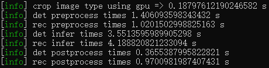

# PaddleOCRv4_TensorRT
## Environment
* cuda 12.4
* cudnn 8
* tensorrt-cuda12.1-trt10.1.0.27
* opencv 4.10.0 with cuda support
* opencv_freetype (optional, If you want show result in chinese)

## Configuration

This project supports configuration via a `config.json` file. You can find the default configuration in the `config.json` file in the project root. All configuration values can be overridden with command-line arguments.

Example config.json:
```json
{
  "model_dir": "../models",
  "det_trt_model": "{model_dir}/det_model.trt",
  "det_onnx_model": "{model_dir}/det_model.onnx",
  "rec_trt_model": "{model_dir}/rec_model.trt",
  "rec_onnx_model": "{model_dir}/rec_model.onnx",
  "label_file": "{model_dir}/ppocr_keys_v1.txt",
  "default_port": 8080,
  "log_level": "info",
  "use_onnx": false
}
```

## How to run
* modify the OpenCV_DIR, fmt_DIR, TensorRT_DIR, spglog_INCLUDE_DIRS path in **CmakeLists.txt**
* modify the path parameters.txt in **main.cpp**

```
mkdir build
cd build
cmake ..
make -j
./run_inference_benchmark --config ../config.json
```

## Running the HTTP Service

To run the OCR service:

```
./ocr_service --config ../config.json
```

See [README_SERVICE.md](file:///E:/do2024/others/PaddleOCRV4-TensorRT/README_SERVICE.md) for more details on the HTTP service.

## Command Line Arguments

Both `run_inference_benchmark` and `ocr_service` support the following command line arguments which override the config file values:

- `--config` or `-c`: Path to the configuration file (default: config.json)
- `--model_dir` or `-md`: Directory containing all model files
- `--det_trt_model` or `-dtm`: Path to the detection TensorRT model
- `--det_onnx_model` or `-dom`: Path to the detection ONNX model
- `--rec_trt_model` or `-rtm`: Path to the recognition TensorRT model
- `--rec_onnx_model` or `-rom`: Path to the recognition ONNX model
- `--label_file` or `-lf`: Path to the label file
- `--port` or `-p`: Port to run the service on (only for ocr_service)

## Model Types

This project supports both TensorRT (.trt) and ONNX (.onnx) models. You can switch between them by setting the `use_onnx` configuration option:
- `use_onnx: false` (default) - Use TensorRT models for maximum performance
- `use_onnx: true` - Use ONNX models for easier deployment and debugging

## Result


In my PC => 12700 + rtx2080.
The time consumption is like these with 50 times model warmup and 1000 times inference.


# Thanks to

- [tensorrt-cpp-api](https://github.com/cyrusbehr/tensorrt-cpp-api) for creating a easy-to-use TensorRT C++ API Tutorial.

- [PaddleOCRv2_TensorRT](https://github.com/zwenyuan1/PaddleOCRv2_TensorRT) for creating some C++ implemention of PaddleOCR preprocess and postprocess method.

- [PaddleOCR](https://github.com/PaddlePaddle/PaddleOCR) for creating awesome and practical OCR tools that help users train better models and apply them into practice.